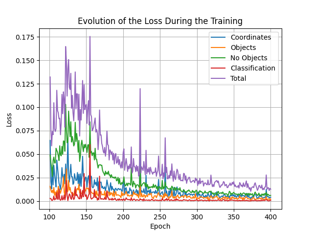
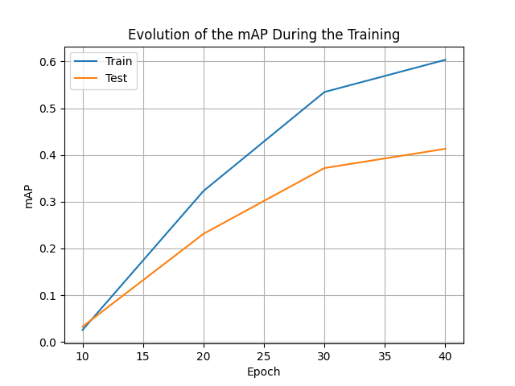

# YOLO from scratch

Computer Vision II, year 4 of the Mathematical Engineering and AI degree, ICAI (Fall 2025).

Single-stage YOLO detector (7x7 grid, two boxes per cell) trained from scratch to detect raccoons, with its loss, IoU, non-maximum suppression and training loop. mAP above 0.4 at epoch 40.

## What it does

- **`YOLO`**: convolutional backbone and head that predict, for each cell of a 7x7 grid, two boxes with confidence and the class score.
- **`YOLOLoss`**: the YOLO v1 loss, split into coordinate, object, no-object and class terms, with the responsible box chosen by IoU and weights of 5 for coordinates and 0.25 for cells without objects.
- **`RaccoonDataset`**: loads images and turns the box annotations into the grid target.
- **`iou`**, **`nms`** and conversion of predictions back to image coordinates.
- **`Trainer`**: training and validation loop that tracks the mean average precision.

## Results

The detector reaches a mAP above 0.4 at epoch 40.

| Training loss | Validation mAP |
|---|---|
|  |  |

## Run

The raccoon dataset used in the course is not included. With the images in `data/images/` and the labels in `data/labels_resized/`:

```bash
uv sync
uv run python -m src.model.train
```

## Authorship

Built on a starter repository from the course staff. [CONTRIBUTION.md](CONTRIBUTION.md) lists which files I changed and links the commits, so my part can be read on its own.
